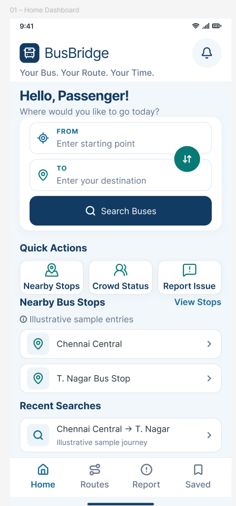
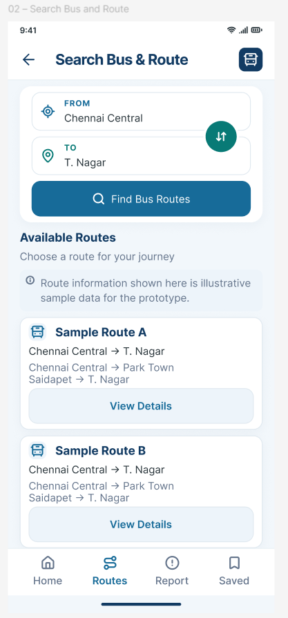
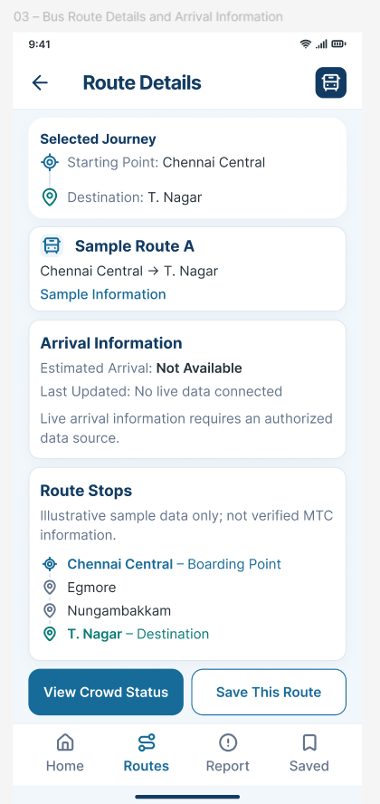
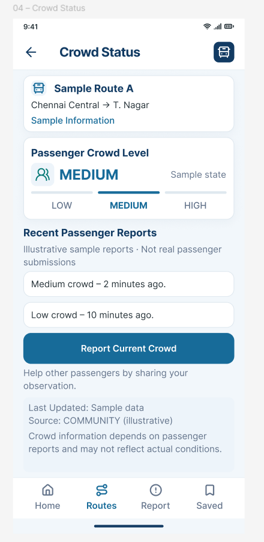
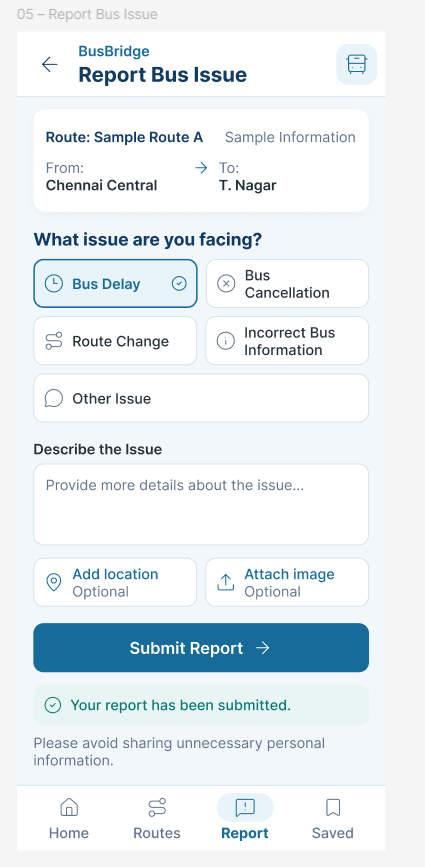
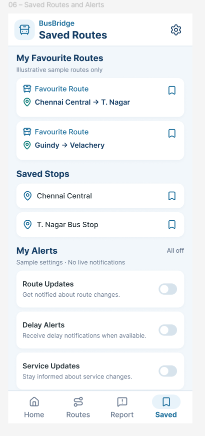
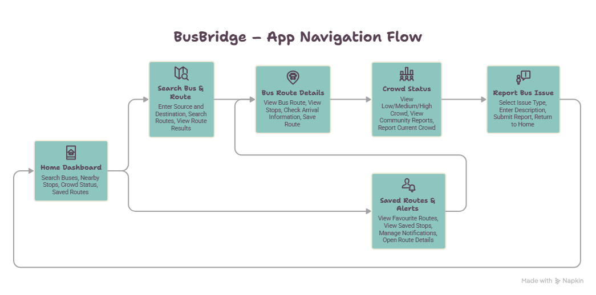

# SWYNEX-App-Concept-and-Screen-Flow
BusBridge – Public Bus Information Gap Solver | SWYNEX Internship Task |
# 🚌 BusBridge – Public Bus Information Gap Solver

**Your Bus. Your Route. Your Time.**

BusBridge is a public transportation utility app concept designed to make bus travel easier, clearer, and more accessible for passengers in Chennai, Tamil Nadu.

The project focuses on helping commuters find bus routes, understand stops, check arrival information where available, view community-reported crowd status, and report service-related issues.

> **Project Status:** UI/UX Concept and Prototype – SWYNEX Technologies Internship, Task 1.

---

## 📌 Problem Statement

Public bus passengers may face difficulties such as:

- Finding the correct bus route for their destination.
- Identifying boarding points and intermediate stops.
- Understanding route connections.
- Getting reliable bus arrival information.
- Knowing about delays, cancellations, or route changes.
- Understanding crowd conditions before boarding.

These challenges can make everyday public transportation confusing, especially for new passengers and occasional travelers.

## 💡 Proposed Solution

BusBridge aims to provide a simple and user-friendly platform that brings important bus journey information together in one place.

The proposed application includes route search, bus stop information, arrival estimates where supported, community-based crowd updates, issue reporting, and saved routes.

## 🎯 Target Users

- College students
- Daily commuters
- Office employees
- New passengers
- Senior citizens
- Occasional travelers

**Initial Geographic Focus:** Chennai, Tamil Nadu, India.

## ✨ Key Features

| Feature | Description |
|---|---|
| Home Dashboard | Quick access to bus search and important information. |
| Bus Route Search | Search for buses between source and destination. |
| Route Details | View route information and intermediate stops. |
| Arrival Information | Display arrival estimates where reliable information is available. |
| Crowd Status | View community-reported crowd levels: Low, Medium, or High. |
| Report an Issue | Report delays, cancellations, route changes, and incorrect information. |
| Saved Routes | Save frequently used routes and stops. |
| Alerts | Receive relevant route and service notifications when supported. |

## 📱 Proposed Application Screens

The application is planned with six primary screens:

1. **Home Dashboard** – Main dashboard with source and destination search.
2. **Search Bus and Route** – Search and view available route options.
3. **Bus Route Details and Arrival Information** – View route stops and arrival information.
4. **Crowd Status** – Check community-reported passenger crowd levels.
5. **Report Bus Issue** – Submit bus-related issues and service updates.
6. **Saved Routes and Alerts** – Access favourite routes and notification preferences.

### 🖼️ Screen Designs

| Screen | Preview |
|---|---|
| **01 – Home Dashboard** |  |
| **02 – Search Bus & Route** |  |
| **03 – Route Details & Arrival** |  |
| **04 – Crowd Status** |  |
| **05 – Report Bus Issue** |  |
| **06 – Saved Routes & Alerts** |  |

## 🔄 Navigation Flow

Home Dashboard → Search Bus and Route → Route Results → Route Details

From Route Details, users can:
- View crowd status.
- Report a bus issue.
- Save a route.

Users can also access Saved Routes directly through the bottom navigation.

### 📊 Navigation Flow Diagram




## 🛠️ Proposed Technology Stack

| Technology | Purpose |
|---|---|
| Flutter | Mobile application development |
| Node.js and Express.js | Backend API development |
| PostgreSQL | Database management |
| OpenStreetMap | Map and location visualization |
| Firebase Cloud Messaging | Push notifications |
| Git and GitHub | Version control and project management |
| Figma | UI/UX design and prototyping |

*These are proposed technologies for future implementation. The current Task 1 deliverable focuses on the app concept, documentation, screen design, and navigation flow.*

## 🔍 Data Reliability and Limitations

BusBridge is currently a concept/prototype and does not claim to provide live MTC bus tracking or officially integrated transport data.

- Official information will be labelled as **OFFICIAL**.
- Arrival estimates will be labelled as **ESTIMATED**.
- Passenger-submitted information will be labelled as **COMMUNITY**.
- Community reports will include timestamps.
- Live bus tracking will require access to a reliable and authorized GPS data source.
- Prototype screens may use illustrative sample data, clearly identified as sample information.

## 🚀 Future Enhancements

- Real-time bus tracking through authorized GPS feeds.
- Integration with verified public transport information sources.
- Multilingual support, including Tamil and English.
- Improved route recommendations.
- Passenger notifications for service changes.
- Better accessibility features for all passengers.

## 📂 Project Structure

```text
SWYNEX-App-Concept-and-Screen-Flow/
│
├── README.md
│
├── Documentation/
│   └── BusBridge_Project_Document.pdf
│
├── Design/
│   ├── Home.png
│   ├── Search_Route.png
│   ├── Route_Details.png
│   ├── Crowd_Status.png
│   ├── Report_Issue.png
│   └── Saved_Routes.png
│
└── Flowchart/
    └── Navigation_Flow.png
```

## 🎓 Internship Information

- **Organization:** SWYNEX Technologies
- **Internship Task:** Task 1 – App Concept and Screen Flow
- **Project Name:** BusBridge
- **Domain:** Mobile Application Development
- **Category:** Public Transportation / Utility Application
- **Initial Target Location:** Chennai, Tamil Nadu

## 👨‍💻 Author

**Naveen Kumar**

Student Developer | Mobile Application Development

## 📄 License

This repository is created for educational and internship purposes as part of the SWYNEX Technologies Internship Task 1.

---

**BusBridge – Making Public Bus Travel Simpler and Smarter.** 🚌
